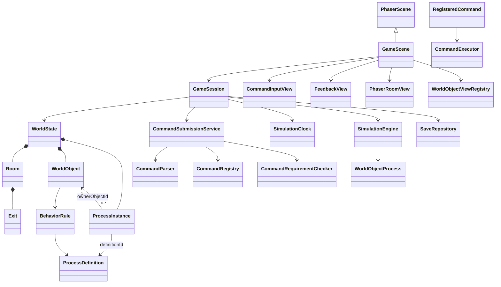
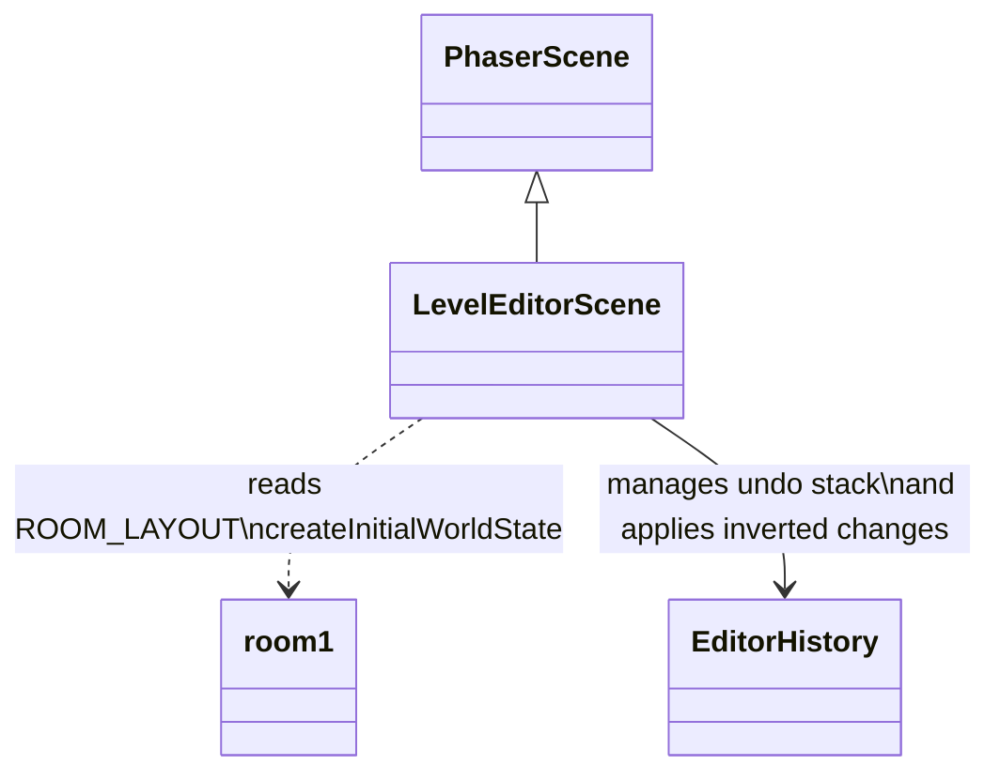

# Game Architecture

## Scope

This document describes the command-driven RTS game architecture and its first playable room. The repository uses Vite, TypeScript, and Phaser 4.2.1.

## Architectural decisions

- One `GameScene` owns the Phaser runtime scene. The bottom command input and all game feedback are presented inside the game view.
- The game uses a 1920×1080 scene size and Phaser `FIT` scaling, centered in the browser viewport. It preserves the full scene at every viewport ratio and fills any unused area with a dark background; it does not enter browser fullscreen mode.
- The game world is a TypeScript domain model. Phaser objects render that model but are not the authoritative world state.
- Directory and file terminology is a command-facing metaphor. A virtual path resolves to a `Room` or `WorldObject`; the game does not model entities as operating-system files and never invokes the host shell.
- Only registered virtual command executors are executable. The grammar accepts one command per submitted line; pipes, chained commands, and player-written scripts are outside this foundation.
- A submitted command runs synchronously and updates world state or object intent. Autonomous world behavior advances separately in fixed simulation ticks and never pauses; the input mode sets the Time Scale (see ADR 0005).
- `ProcessDefinition` and `ProcessInstance` are separate concepts. A world object can have zero or more running instances, and behavior rules can select a definition based on conditions.
- `TickSimulationEngine` accumulates elapsed game time into fixed `1000 / 60` ms ticks, visits world objects in stable array order, and runs each matching behavior process once per tick.
- Collision, Reach checks, and nearest-target selection are domain-owned AABB logic behind a `CollisionWorld` interface, not Phaser physics (ADR 0007). Interaction does not depend on Discovery (ADR 0006).
- Persistence is behind a repository interface and targets browser-local storage. A save snapshot includes world state and raw command history. The trigger and cadence for saving are outside this architecture decision.

## Runtime responsibilities

### Phaser scene

`GameScene` extends `Phaser.Scene` and uses a 1920×1080 reference coordinate space. Phaser scales that complete scene proportionally to fit the browser viewport and centers it over a dark background when the viewport has a different aspect ratio. It creates the Room 1 world, session, room and object views, input, feedback, and outcome panels, then forwards Phaser's frame delta to the session. It does not contain command rules or world-object process logic. `createGame` starts with `GameScene`; a future start screen can become the first scene in the scene list.

`PhaserCommandInputView` is mounted at the bottom center of `GameScene`. In Command Mode it accepts printable English ASCII, edits with the supported cursor keys, wraps at a fixed character count, and scrolls to keep the cursor visible. Enter submits the complete input string and clears the field. In Movement Mode the field is dimmed, the cursor is hidden, and the hint "Press Enter to type a command" is shown; output and feedback remain visible. `PhaserRoomView` projects room and World Object state to Phaser images; `PhaserGameOutcomePanel` presents Game Over and Congratulations states.

### Input modes

- The game starts in Movement Mode. Enter toggles between Movement Mode and Command Mode.
- A submitted command switches back to Movement Mode, including empty input, parse failures, and rejected commands. A command result may carry an optional `inputAfter` field (`'movement' | 'command'`, default `'movement'`) to keep input open; no current command uses it.
- Movement Mode: WASD and the arrow keys move the Player Character continuously, with diagonal speed normalized. K or right mouse button picks up; J or left mouse button attacks. Key and button bindings live in one `InputBindings` object in the presentation layer; the domain receives abstract actions (`move`, `pickUp`, `attack`).
- Command Mode: the Player Character cannot act, and pick-up and attack are ignored. Simulation time runs at the Time Scale `COMMAND_MODE_TIME_SCALE = 0.25`; Movement Mode runs at 1.
- Pressing Enter while holding a movement key latches that direction. The Player Character keeps moving until it meets a wall, leaves the room, or the player presses Enter again. Movement keys held at the moment of Enter are suppressed in the Command Input, repeats included, until released, so they are not typed as text.
- The prompt shows the current room and updates when the room changes.

### Command input behavior

- Tab on an empty input completes `help`. Otherwise it completes registered commands and visible room entries in any token position.
- A unique match completes the token and adds a space at the end; ambiguous matches extend their common prefix when possible.
- Hidden objects are unavailable to completion until discovered with `ls` or by interacting with them.
- Ctrl+Backspace deletes the preceding word and its preceding whitespace.
- Up/Down navigate submitted command history; Down past the newest entry restores the draft.

### Application session

`GameSession` coordinates the current `WorldState`, command submission, input mode, player actions, and simulation. `InputModeController` is the Phaser-independent state machine for Movement and Command Mode; tests (`*.test.ts`, run with `npm test`) sit beside the code they cover. A submitted raw string is added to command history and passed to command submission immediately. The simulation advances from the scene update loop through `SimulationClock` and `SimulationEngine`.

### Command submission

The synchronous submission pipeline is:

1. `VirtualCommandParser` parses one input line into a command name, options, and arguments.
2. `RegisteredCommandRegistry` resolves the command name against the implemented allow-list.
3. `CommandRequirementChecker` checks the selected command's requirements against the current command and world state.
4. If the requirements pass, the registered command's `CommandExecutor` updates domain state.
5. `CommandResult` returns success feedback or a failure reason to the in-game feedback view.

Syntax parsing, allow-list lookup, requirement checking, and execution are separate responsibilities. `ls` marks discoverable objects in the current Room as discovered; the view reveals them from world state. Requirement failures are returned to the UI with their reason. Feedback uses a required variant: object-attached feedback has a target object ID; general feedback has no object target. The game event that creates feedback selects the variant.

### World and process model

`WorldState` is the source of truth for rooms, world objects, active process instances, the current room, simulation tick, game outcome, and raw command history. `Room` is the game's independently enterable area and owns its Exits. `WorldObject` is a domain entity with identity, room ownership, metadata, behavior rules, and runtime state. Its metadata can contain information that player commands do not reveal.

`BehaviorRule` connects a world object to a condition and a `ProcessDefinition`. On each simulation tick, `TickSimulationEngine` evaluates those rules and invokes the registered logic for each matching definition. A `ProcessInstance` stores runtime state for the owner object and process definition. The relationship is represented by IDs; neither processes nor world objects are represented as files.

`VirtualWorldPathResolver` maps command-facing virtual paths to room or object IDs through the `WorldPathResolver` contract. It does not access the host filesystem.

### Simulation time

`RealtimeSimulationClock` converts Phaser's frame delta into game delta and multiplies it by the Time Scale set from the input mode. `TickSimulationEngine` accumulates that delta and runs fixed `SIMULATION_TICK_MS = 1000 / 60` ticks, so object behavior does not depend on the browser's render frame rate. Rendering is decoupled from ticks: the engine keeps each positioned object's position before the latest tick and `GameSession.getRenderPosition` returns a position blended by the fraction of the next tick already accumulated, so motion stays smooth at any frame rate and Time Scale. A single frame feeds the simulation at most 250 ms of real time. Visual effects and animations should draw from the same render positions and read the current Time Scale so they slow with the world. Future commands that pause or change speed should control the clock through the command layer rather than reaching into Phaser's frame loop.

### Combat and collision

Every Character has Health, initially 100. A `WeaponDefinition` holds `id`, `damage`, `cooldownMs`, `reach`, and a single-target attack shape that leaves room for area weapons later. Definitions: unarmed (damage 10, cooldown 0.5 s, reach 5 px), Dagger (damage 35, cooldown 0.5 s, reach 10 px), and a separate Guard definition (damage 20, cooldown 1 s, reach 5 px). A Character with no equipped weapon uses the unarmed definition. Cooldowns count simulation time, so they follow the Time Scale.

An attack damages the nearest other Character within the weapon's Reach, measured as the gap between bounding boxes. Pick-up takes the nearest pick-up-able object within `PICKUP_REACH = 10` px and equips it. Picking up or attacking an undiscovered object marks it discovered. `CollisionWorld` provides boundary clamping, edge-gap distance, and nearest-target selection with domain-owned axis-aligned boxes (ADR 0007).

### First room behavior

Room 1 starts with the Player Character in the upper-left, a hidden Dagger in the lower-left, and a hidden Guard on the right. The room's right-side Exit leads to Room 2. `ls` reveals the Dagger and Guard, but they can be interacted with before that. The player walks with WASD, picks up the Dagger with K or right click, and attacks with J or left click.

The Guard process starts pursuit while the Player Character is in the room's right half, stops when the Player Character leaves it, and attacks within its Reach. The Player Character reaching zero Health sets the Game Over outcome. A defeated Guard stops pursuing and is removed from the view. Walking into the Exit area enters Room 2 and sets the Congratulations outcome. Health bars appear above the Player Character and the Guard.

### Persistence

`WorldStateCodec` converts between live domain classes and the serializable `WorldStateSnapshot`. `SaveSnapshot` also carries raw command history. `SaveRepository` hides the storage mechanism; `LocalStorageSaveRepository` is the browser-local adapter. Phaser Game Objects, active keyboard focus, and other presentation details are reconstructed or restored separately. The architecture does not choose when snapshots are captured.

## Class relationships



`PhaserScene` in the diagram means `Phaser.Scene`. Services collaborate through composition and interfaces rather than a deep class tree. World-object process logic operates on serializable domain state, not Phaser Game Objects.

## Source layout

```text
CONTEXT.md
docs/
  architecture.md
  adr/
    0001-phaser-independent-world-state.md
    0002-virtual-allowlisted-commands.md
    0003-fit-full-scene-to-viewport.md
    0004-world-objects-act-on-simulation-ticks.md
    0005-input-mode-sets-time-scale.md
    0006-interaction-ignores-discovery.md
    0007-domain-owned-aabb-collision.md
src/
  main.ts
  game/
    createGame.ts
    application/
      GameSession.ts
      InputModeController.ts
    content/
      createRoom1Session.ts
      room1.ts
      room1Commands.ts
    scenes/
      GameScene.ts
      LevelEditorScene.ts
      levelEditorHistory.ts
    domain/
      BasicWorldObject.ts
      ids.ts
      JsonValue.ts
      Room.ts
      WorldObject.ts
      WorldObjectState.ts
      WorldPath.ts
      WorldPathResolver.ts
      CharacterState.ts
      CollisionWorld.ts
      CombatService.ts
      PickUpService.ts
      WeaponDefinition.ts
      VirtualWorldPathResolver.ts
      WorldState.ts
    processes/
      BehaviorRule.ts
      ProcessDefinition.ts
      ProcessInstance.ts
    commands/
      ParsedCommand.ts
      CommandHistory.ts
      CommandFeedback.ts
      CommandResult.ts
      CommandRequirement.ts
      CommandParser.ts
      CommandRegistry.ts
      CommandRequirementChecker.ts
      EveryCommandRequirementChecker.ts
      RegisteredCommandRegistry.ts
      VirtualCommandParser.ts
      CommandSubmissionService.ts
      executors/
        base.ts
        ls.ts
    simulation/
      SimulationClock.ts
      SimulationEngine.ts
      RealtimeSimulationClock.ts
      TickSimulationEngine.ts
      room1/
        Room1Processes.ts
    persistence/
      SaveSnapshot.ts
      SaveRepository.ts
      LocalStorageSaveRepository.ts
      WorldStateCodec.ts
      JsonWorldStateCodec.ts
    presentation/
      CommandInputView.ts
      PhaserCommandInputView.ts
      FeedbackView.ts
      PhaserFeedbackView.ts
      PhaserRoomView.ts
      PhaserGameOutcomePanel.ts
      InputBindings.ts
      WorldObjectViewRegistry.ts
  assets/
    game/
      fonts/
        PressStart2P-Regular.ttf
        OFL.txt
      ui/
        textbox.png
      characters/
        player/idle.png
        guard/idle.png
      items/
        weapons/dagger.png
```

The Press Start 2P font, distressed textbox frame, monochrome character art, and dagger image form the initial presentation assets.

## Level editor

`LevelEditorScene` is a separate Phaser scene (key `'level-editor'`) for visually adjusting the starting positions and display sizes of room1's World Objects. It is registered in the scene list alongside `GameScene` and is activated from gameplay with **F2**; pressing **F2** again or **Escape** returns to `GameScene`.

The editor does not touch live `WorldState` or any simulation code. It reads the initial layout from `createInitialWorldState()` and `ROOM_LAYOUT` in `room1.ts`, displays all three World Objects (player, dagger, guard) as draggable sprites, and docks its control dashboard below the room view (`y = 720..1010`) so the entire room (`y = 80..700`) remains completely unobstructed. It lets the designer:

- **Drag** a sprite to reposition it (arrow keys for 1 px nudge, Shift+arrow for 10 px).
- **Drag the yellow corner handle** or press **+**/**−** to scale a sprite uniformly. Scale buttons in the properties panel (×1.1 / ÷1.1) are also available.
- **Tab / Shift+Tab** to cycle selection; clicking a sprite or its name in the properties panel selects it.
- **Ctrl+Z** to undo edits. Undo is implemented through an invertible change model where every operation defines its reverse (e.g., move `(dx, dy)` inverts to `(-dx, -dy)`, scale `factor` inverts to `1 / factor`), restoring the previous transform.
- **P** to toggle the visibility of the bottom properties panel.
- **Export to Console** (green button inside the export section) prints a ready-to-paste `ROOM_LAYOUT` snippet and a table of display sizes to the browser developer console. The designer copies those values back into `room1.ts` by hand.

The editor is intentionally read-only with respect to source files: it exports values to the console and leaves the edit to the developer. No persistence or live hot-reload of `room1.ts` occurs inside the editor.

### Class relationships (editor additions)



## Framework references

- [Phaser Scene API](https://docs.phaser.io/api-documentation/4.0.0/class/scene) — the Phaser scene base class and scene lifecycle.
- [MDN: `localStorage`](https://developer.mozilla.org/en-US/docs/Web/API/Window/localStorage) — browser storage that persists across browser sessions.
