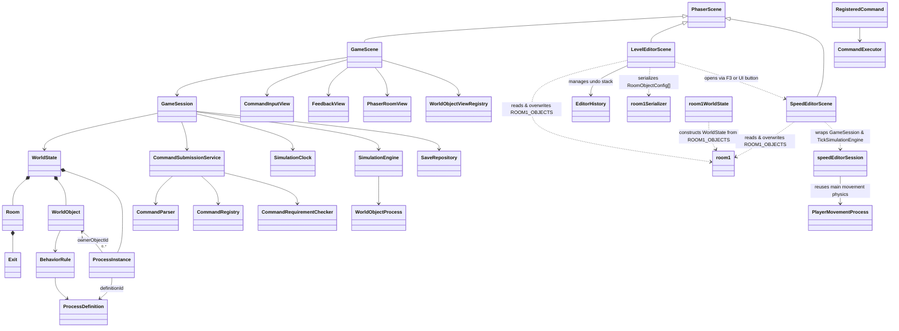

# Game Architecture

## Scope

Architecture specification for the command-driven RTS game and initial room (Vite, TypeScript, Phaser 4.2.1).

## Architectural Decisions

- **Phaser Scene**: `GameScene` owns the Phaser runtime scene, hosting in-view command input and feedback.
- **Viewport Scaling**: 1920×1080 scene with Phaser `FIT` scaling, centered with dark letterboxing; no browser fullscreen.
- **Authoritative Model**: Domain state is authoritative in TypeScript; Phaser objects strictly render domain state.
- **Virtual Hierarchy**: Virtual paths (`Room`, `WorldObject`) are domain metaphors; no OS filesystem or host shell access.
- **Command Whitelist**: Only registered virtual command executors run, one per line (no pipes, chaining, or scripting).
- **Execution & Simulation**: Commands run synchronously; autonomous behavior advances in fixed simulation ticks (input mode sets Time Scale, ADR 0005).
- **Process Model**: `ProcessDefinition` is reusable behavior; `ProcessInstance` tracks runtime state per world object.
- **Tick Engine**: `TickSimulationEngine` accumulates time into fixed 60 Hz (`1000/60` ms) ticks, running matching behavior processes per object in stable order.
- **Collision & Reach**: Domain AABB logic (`CollisionWorld`) handles collision, reach, and targeting without Phaser physics (ADR 0007). Interaction ignores Discovery (ADR 0006).
- **Persistence**: `SaveRepository` (`LocalStorageSaveRepository`) stores snapshots with domain state and command history.

## Runtime Responsibilities

### Phaser Scene

`GameScene` (1920×1080 reference space) mounts Room 1 domain state, session, room/object views, input, feedback, and outcome panels, forwarding Phaser's frame delta to `GameSession`. `createGame` boots with `GameScene`.

`PhaserCommandInputView` sits bottom-center. In Command Mode, it accepts printable ASCII, cursor editing, auto-wrapping, and history navigation; Enter submits. In Movement Mode, it is dimmed with a typing prompt hint. `PhaserRoomView` projects world objects to Phaser sprites; `PhaserGameOutcomePanel` displays Game Over / Congratulations states.

### Input Modes

| Mode | Time Scale | Player Control | Combat & Actions |
|---|:---:|---|---|
| **Movement** | 1.00 | WASD / Arrows (responsive physics) | J / Left-click: attack (auto-pickup on contact) |
| **Command** | 0.25 | Disabled (or latched direction) | Ignored |

- **Toggle**: Enter toggles between Movement and Command Mode.
- **Submission**: Commands switch back to Movement Mode (unless `inputAfter` overrides).
- **Latched Movement**: Pressing Enter while holding movement keys latches velocity until collision, room exit, or Enter; latched keys are suppressed from typing input.
- **Prompt**: Displays active room path.

### Command Input Behavior

- **Tab Completion**: Tab on empty input completes `help`; otherwise completes registered commands and discovered room entries. Unique matches append a trailing space; ambiguous matches complete the common prefix.
- **Discovery Gate**: Hidden objects require discovery (`ls` or direct interaction) before autocomplete inclusion.
- **History & Editing**: `Ctrl+Backspace` deletes previous word; `Up`/`Down` navigates command history (down past newest restores draft).

### Application Session & Command Pipeline

`GameSession` orchestrates `WorldState`, input mode, player actions, command execution, and simulation ticks.

Synchronous submission pipeline:
1. `VirtualCommandParser`: Parses raw input into command, options, arguments.
2. `RegisteredCommandRegistry`: Resolves command name against allow-list.
3. `CommandRequirementChecker`: Validates requirements against world state.
4. `CommandExecutor`: Synchronously updates domain state.
5. `CommandResult`: Emits object-attached or general feedback.

### World and Process Model

- `WorldState`: Root aggregate for rooms, world objects, active process instances, current room, simulation tick, outcome, and command history.
- `Room`: Enterable area owning exits.
- `WorldObject`: Domain entity with identity, room ID, metadata, behavior rules, and runtime state.
- `BehaviorRule`: Maps object condition to `ProcessDefinition`.
- `VirtualWorldPathResolver`: Resolves virtual command paths to room/object IDs (no host filesystem access).

### Simulation Time

`RealtimeSimulationClock` scales Phaser frame delta by active Time Scale (max 250 ms real delta clamped per frame). `TickSimulationEngine` accumulates game delta into fixed 60 Hz ticks. `GameSession.getRenderPosition` interpolates object positions between ticks for smooth visual rendering decoupled from tick rate.

### Combat and Collision

Characters start with 100 Health. Weapon definitions scale cooldowns with simulation time:

| Weapon | Damage | Cooldown | Reach | Notes |
|---|:---:|:---:|:---:|---|
| Unarmed | 10 | 0.5s | 5 px | Default when unarmed |
| Dagger | 35 | 0.5s | 10 px | Single-target |
| Guard | 20 | 1.0s | 5 px | Hostile guard attack |

Attacks damage nearest character within Reach (bounding-box gap). Items (including Dagger) are automatically picked up when within `PICKUP_REACH = 10` px; both actions mark undiscovered targets discovered. Hitboxes scale proportionally via `scaleX`/`scaleY` from base dimensions (`CHARACTER_SIZE` 110×160, `DAGGER_SIZE` 72×72).

### First Room Behavior

Room 1 initializes with Player Character (upper-left), hidden Dagger (lower-left), and hidden Guard (right). Exiting right leads to Room 2:
- `ls` discovers hidden objects; interaction works prior to discovery.
- The player walks with WASD, automatically picks up the Dagger (and any items) on contact/reach, and attacks with J or left click.
- Guard pursues player when player enters room's right half; attacks within Reach.
- Player reaching 0 Health triggers `game-over`. Defeating guard stops pursuit. Reaching exit triggers `congratulations`.

### Persistence

`WorldStateCodec` converts between `WorldState` and `WorldStateSnapshot`. `SaveSnapshot` bundles domain state and raw command history into `LocalStorageSaveRepository`.

## Class Relationships



## Source Layout

```text
src/
  main.ts, createGame.ts
  application/  GameSession.ts, InputModeController.ts
  content/      room1.ts, room1Constants.ts, room1Commands.ts, room1Serializer.ts, room1WorldState.ts, createRoom1Session.ts
  scenes/       GameScene.ts, LevelEditorScene.ts, levelEditorHistory.ts, SpeedEditorScene.ts, speedEditorSession.ts
  domain/       WorldState.ts, Room.ts, WorldObject.ts, BasicWorldObject.ts, CharacterState.ts, CollisionWorld.ts, CombatService.ts, PickUpService.ts, WeaponDefinition.ts, ids.ts, JsonValue.ts, WorldPath.ts, WorldPathResolver.ts, VirtualWorldPathResolver.ts
  processes/    BehaviorRule.ts, ProcessDefinition.ts, ProcessInstance.ts
  commands/     CommandSubmissionService.ts, CommandRegistry.ts, RegisteredCommandRegistry.ts, CommandParser.ts, VirtualCommandParser.ts, CommandRequirement.ts, CommandRequirementChecker.ts, EveryCommandRequirementChecker.ts, ParsedCommand.ts, CommandHistory.ts, CommandFeedback.ts, CommandResult.ts, executors/{base.ts, ls.ts}
  simulation/   SimulationClock.ts, SimulationEngine.ts, RealtimeSimulationClock.ts, TickSimulationEngine.ts, room1/Room1Processes.ts
  persistence/  SaveSnapshot.ts, SaveRepository.ts, LocalStorageSaveRepository.ts, WorldStateCodec.ts, JsonWorldStateCodec.ts
  presentation/ CommandInputView.ts, PhaserCommandInputView.ts, FeedbackView.ts, PhaserFeedbackView.ts, PhaserRoomView.ts, PhaserGameOutcomePanel.ts, InputBindings.ts, WorldObjectViewRegistry.ts
assets/         fonts/, ui/, characters/{player, guard}/, items/weapons/
docs/           architecture.md, adr/0001..0007
```

## Level Editor

`LevelEditorScene` (`'level-editor'`) provides visual editing of room1 world object positions and sizes. Toggled from gameplay with **F2** (or **Escape** to return).

Editable configurations export directly to `room1.ts` (`ROOM1_OBJECTS`). Objects use base sizes (`CHARACTER_BASE_SIZE` 176×176, `DAGGER_SIZE` 72×72) with default 1.00 scales. Editor controls dock below room view (`y = 720..1010`), leaving room area (`y = 80..700`) unobstructed.

### Features & Controls

| Action | Control |
|---|---|
| **Reposition** | Drag sprite, or arrow keys (1 px, Shift: 10 px) |
| **Uniform Scale** | Drag yellow corner handle, `+`/`-` keys, or panel `×1.1` / `÷1.1` buttons |
| **Spawn / Despawn** | `+ GUARD`, `+ DAGGER` buttons; despawn with `REMOVE SELECTED` or `Del`/`Backspace` |
| **Selection** | Click sprite, panel list entry, or cycle with `Tab` / `Shift+Tab` |
| **Character Stats** | Edit guard `max_health` & `speed`, or player `max_health` (`+/-` 10, Shift: 50, click value for prompt) |
| **Speed Editor Access** | `OPEN SPEED EDITOR (F3)` button or **F3** shortcut |
| **Undo / Redo** | `Ctrl+Z` reverses operations via invertible delta stack (move, scale, stat, spawn/despawn) |
| **Toggle Panel** | **P** toggles bottom property panel visibility |
| **Save** | `SAVE TO ROOM1.TS` overwrites file via `/api/save-room1` and syncs in-memory `ROOM1_OBJECTS` |

## Speed Editor

`SpeedEditorScene` (`'speed-editor'`) tunes player movement physics in real time. It directly reuses main game simulation (`GameSession`, `InputModeController`, `TickSimulationEngine`, `PlayerMovementProcess`).

### Physics Parameters

| Parameter | Default | Unit | Description |
|---|:---:|:---:|---|
| `maxSpeed` | 300 | px/s | Velocity cap in movement mode |
| `acceleration` | 2500 | px/s² | Speed-up rate toward input direction |
| `frictionAcceleration` | 3000 | px/s² | Braking deceleration when movement input stops |
| `turnaroundAcceleration` | 1600 | px/s² | Snappy reversal acceleration opposing velocity |

### Features & Runtime Behavior

- **Live Tuning While Moving**: Keyboard movement runs continuously during mouse interaction, giving immediate tactile feedback on physics changes.
- **Step & Direct Input**: Parameter buttons (`+` / `−` with step sizes, Shift: 5x multiplier) or click value for exact number prompt. Clamped to minimum safe values.
- **Live Telemetry**: Displays real-time speed (`px/s`), velocity vectors (`vx`, `vy`), input direction (`moveX`, `moveY`), and dynamic visual speedometer gauge.
- **Reset Position**: **R** or `RESET POS (R)` snaps player to start coordinates with zero velocity for standstill acceleration trials.
- **Reset Defaults**: Restores default physics values.
- **Save**: Writes updated speed directly to `src/game/content/room1.ts` via `/api/save-room1` and updates `ROOM1_OBJECTS`.
- **Navigation**: Accessed from Level Editor via `OPEN SPEED EDITOR (F3)` or **F3**; **Escape** returns to Level Editor, **F2** returns to gameplay.

## Framework References

- [Phaser Scene API](https://docs.phaser.io/api-documentation/4.0.0/class/scene) — scene lifecycle.
- [MDN: localStorage](https://developer.mozilla.org/en-US/docs/Web/API/Window/localStorage) — browser persistence.
