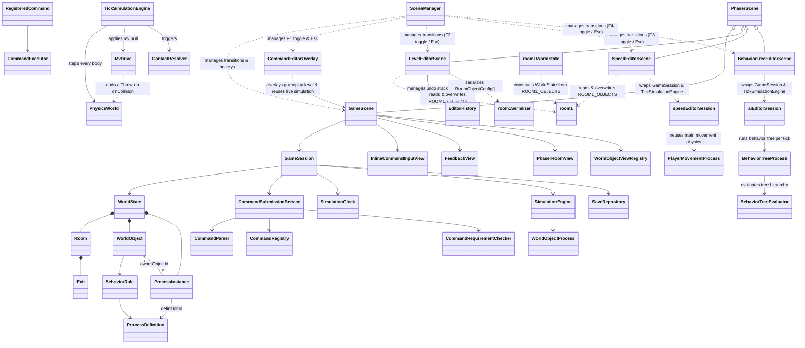

# Game Architecture

## Scope

Architecture specification for the command-driven RTS game and initial room (Vite, TypeScript, Phaser 4.2.1).

## Architectural Decisions

- **Phaser Scene**: `GameScene` owns the Phaser runtime scene, hosting in-view command input and feedback.
- **Viewport Scaling**: 1920×1080 scene with Phaser `FIT` scaling, centered with dark letterboxing; no browser fullscreen.
- **Authoritative Model**: Domain state is authoritative in TypeScript; Phaser objects strictly render domain state.
- **Virtual Hierarchy**: Virtual paths (`Room`, `WorldObject`) are domain metaphors; no OS filesystem or host shell access.
- **Command Whitelist**: Only registered virtual command executors run, one per line (no pipes, chaining, or scripting).
- **Execution & Simulation**: Commands run synchronously; autonomous behavior advances in fixed simulation ticks (input mode sets Time Scale, ADR 0005).
- **Process Model**: `ProcessDefinition` is reusable behavior; `ProcessInstance` tracks runtime state per world object.
- **Tick Engine**: `TickSimulationEngine` accumulates time into fixed 60 Hz (`1000/60` ms) ticks. A tick runs the processes (which apply Forces), `MvDrive`, the physics step, the processes' `afterPhysics` hooks, contacts, and `MvDrive.settle`, in stable object order.
- **Collision & Reach**: Domain collision logic (`CollisionWorld`, axis-aligned boxes plus circles) handles overlap, reach, and targeting without Phaser physics (ADR 0007, ADR 0011). Interaction ignores Discovery (ADR 0006).
- **Contacts**: Collider Tags on objects and a generic `ContactResolver` decide what a touch triggers (ADR 0008); whether two objects Collide is decided by the same tags (`collidesPhysically`).
- **Physics & Throws**: all movement is Forces integrated by `PhysicsWorld` (drag, speed cap, Collisions with restitution); `mv` only applies a pull through `MvDrive` (ADR 0010, superseding the flight rules of ADR 0009).
- **Persistence**: `SaveRepository` (`LocalStorageSaveRepository`) stores snapshots with domain state and command history.
- **Editor Theme & DRY Guardrails**: Editor scenes and overlays share visual theme constants (`editorTheme.ts`) and storage fallbacks (`editorStorage.ts`). Automated duplication verification is gated via `npm run check:dry` (JSCPD + TypeScript).

## Runtime Responsibilities

### Phaser Scene

`GameScene` (1920×1080 reference space) mounts Room 1 domain state, session, room/object views, input, feedback, and outcome panels, forwarding Phaser's frame delta to `GameSession`. `createGame` boots with `GameScene`.

`InlineCommandInputView` renders a single-line command prompt (`$ <command>`) floating directly beneath the Player Character while holding Shift. `PhaserGameHud` owns the main-game room header, editor shortcuts, lower-left live Health bar, input-mode/time-scale status, control hints, the room's hint banner along the top of the room (sized to its text, hidden in rooms without a `hint`) and the goal line (`GOAL <room.goal>` while an Exit is locked, `DONE …` with how to leave once a gated Exit opens). The main game uses a dark blue background and retains the shared Room coordinates so editor layouts and domain collision remain consistent. HUD objects are destroyed on scene shutdown. No Mana or identity statistics are shown until those systems exist. In Command Mode, the inline prompt accepts printable ASCII, cursor editing, tab completion, and history navigation (`Up`/`Down`); Enter submits and releasing Shift cancels. In Movement Mode, it is hidden. `PhaserRoomView` projects world objects to Phaser sprites (orienting characters horizontally based on `facing` via `flipX`, and rendering equipped items in local holder coordinates `WEAPON_HOLD_OFFSET = { x: 20, y: 26 }` mirrored with the holder's facing direction, translating equipped dagger position along the horizontal facing axis during attacks by `DAGGER_ATTACK_DISTANCE` [30 px] over `DAGGER_ATTACK_DURATION_MS` [200 ms]) and overhead labels (`?` for undiscovered objects, object name once revealed, and `hacker` for the player character; equipped items remain visible with label scale shrunk to `ITEM_LABEL_WIDTH_RATIO` [0.75] of item sprite width to avoid overlapping the character); `PhaserGameOutcomePanel` displays Game Over / Congratulations states.

### Input Modes

| Mode | Time Scale | Player Control | Combat & Actions |
|---|:---:|---|---|
| **Movement** | 1.00 | WASD (responsive physics, turning left/right) | Space: attack (auto-pickup on contact) |
| **Command** | 0.25 | Disabled (or latched direction) | Ignored |

- **Shell Entry & Exit**: Holding Shift while in Movement Mode opens the inline command prompt (`$ `) under the player. Releasing Shift without submitting cancels and clears any unsubmitted command draft. Escape does not close the command utility.
- **Submission**: Commands submitted with Enter execute and switch back to Movement Mode (unless `inputAfter` overrides).
- **Latched Movement**: Pressing Enter or typing an alphabet key while holding movement keys latches velocity until collision, room exit, or Escape/submission; latched keys are suppressed from typing input.
- **Prompt**: Displays the current room as `~/<room>$`.

### Command Input Behavior

- **Tab Completion**: Tab on empty input completes `help`; otherwise completes registered commands, discovered room entries, and the player character's label (`hacker`). Argument positions (after command name and whitespace) complete room entries (including `hacker`) without command name collisions. Unique matches append a trailing space; ambiguous matches complete the common prefix.
- **Discovery Gate**: Undiscovered objects require discovery (`ls` or direct interaction) before autocomplete inclusion; the player character is always discovered.
- **History & Editing**: `Ctrl+Backspace` deletes previous word; `Up`/`Down` navigates command history (down past newest restores draft).

### Application Session & Command Pipeline

`GameSession` orchestrates `WorldState`, input mode, player actions, command execution, and simulation ticks.

Synchronous submission pipeline:
1. `VirtualCommandParser`: Parses raw input into command, options, arguments.
2. `RegisteredCommandRegistry`: Resolves command name against allow-list.
3. `CommandRequirementChecker`: Validates requirements against world state.
4. `CommandExecutor`: Synchronously updates domain state.
5. `CommandResult`: Emits object-attached or general feedback.

### World and Process Model

- `WorldState`: Root aggregate for rooms, world objects, active process instances, current room, simulation tick, outcome, and command history.
- `Room`: Enterable area owning exits.
- `WorldObject`: Domain entity with identity, room ID, metadata, behavior rules, and runtime state. Roles include `player`, `enemy` (hostile characters such as guards), `weapon`, and `object` (such as environmental world objects like `boulder`; its `BoulderProcess` has no behavior of its own, thrown flight is owned by the engine).
- `BehaviorRule`: Maps object condition to `ProcessDefinition`.
- `VirtualWorldPathResolver`: Resolves virtual command paths to room/object IDs (no host filesystem access).

### Simulation Time

`RealtimeSimulationClock` scales Phaser frame delta by active Time Scale (max 250 ms real delta clamped per frame). `TickSimulationEngine` accumulates game delta into fixed 60 Hz ticks. `GameSession.getRenderPosition` interpolates object positions between ticks for smooth visual rendering decoupled from tick rate. Each tick runs the object processes (they only apply Forces), then `MvDrive.drive`, the physics step, the `afterPhysics` hooks, contacts and `MvDrive.settle` (see Physics step).

### Combat and Collision

Characters start with 100 Health. Weapon definitions scale cooldowns with simulation time:

| Weapon | Damage | Cooldown | Reach | Notes |
|---|:---:|:---:|:---:|---|
| Unarmed | 10 | 0.5s | 5 px | Default when unarmed |
| Dagger | 35 | 0.5s | 10 px | Single-target |
| Guard | 20 | 1.0s | 5 px | Hostile guard attack |

Attacks damage nearest character within Reach (bounding-box gap). Items (including Dagger) are automatically picked up when within `PICKUP_REACH = 10` px; both actions mark undiscovered targets discovered. Hitboxes scale proportionally via `scaleX`/`scaleY` from base dimensions (`CHARACTER_SIZE` 110×160, `DAGGER_SIZE` 72×72, `BOULDER_SIZE` 120×120); Reach and pick-up gaps are measured to a circle's edge for circle colliders.

#### Collider Tags and Impact Damage

Each World Object carries `metadata.colliderTags` (typed in `domain/ColliderTag.ts`), set from `role` when the object is built by `createInitialWorldState` (`defaultColliderTags`): a `weapon` role gets `{ class: 'weapon', impactDamageRate: 0.05 }`, `player`/`enemy` get `{ class: 'character' }`, and `object` (the boulder) gets `{ class: 'obstacle' }`. The tags are not stored in `room1.ts` and no editor edits them.

`collidesPhysically(a, b)` (and `rolesCollide` for roles, used by the Level Editor) is the table of which tag classes push each other apart: Character–Character, Character–Obstacle, Obstacle–Obstacle and Weapon–Obstacle. A Weapon passes through Characters and other Weapons, so the Impact Damage trigger below still fires. Trigger rules and physical Collisions are separate: a touch can be both.

`simulation/ContactResolver.ts` visits every object in the current room that has `thrown` set, finds the other objects it overlaps (`CollisionWorld.gap === 0`), and runs the `ContactRule` registered for the pair of tag classes. The single rule, `weaponHitsCharacter`:
- Applies only while the weapon is in flight (`thrown` set); a held or resting dagger never hurts.
- Deals `impactDamageRate × |velocity|` (velocity in game-time px/s, so Time Scale does not change it) to each alive Character, at most once per Throw per Character (`thrown.hitIds`; zero-speed touches also use up the hit; a new `mv` resets `hitIds`). Health stays fractional and a Character is defeated at Health ≤ 0.
- Is a trigger: the weapon keeps flying, nothing else changes, and the Character is not marked discovered. The thrower is not excluded and there is no friendly-fire exemption.
- Thrown Characters and the boulder carry no weapon tag, so they hurt nobody. A Weapon whose Throw has ended (it hit an Obstacle) hurts nobody either.

After the rules run, `applyPlayerDefeat` (`domain/PlayerDefeat.ts`) sets `game-over` if the Player Character was defeated; the guard's attack uses the same function. `TickSimulationEngine` takes the resolver through its options; the Speed Editor passes `contactResolver: null`, so contacts are off there.

#### Physics step (`simulation/PhysicsWorld.ts`)

Every body of the current room (an object with `x/y/width/height`, alive, not a held Weapon) is moved only by Forces. Processes call `applyForce(obj, fx, fy)`, which adds to `forceX/forceY` in the object state; `PhysicsWorld.step` consumes and clears them each tick:

1. **integrate**: `v + F ÷ mass × dt` is capped at `max(max_velocity, the speed before the Force)`, then multiplied by `max(0, 1 − (drag + friction) × dt)`; ground `friction` is left out while the body has `thrown` set. `max_velocity` only limits what a Force can add, so speed given by a Collision is kept. A body with no Force this tick and `|v| < min_velocity` is set to rest. A body with `frozen` set (an arriving Throw) is skipped for the tick.
2. **separate**: bodies that collide physically and already overlap are pushed apart along the shallowest axis (along the contact normal when a circle is involved); only one of each pair moves (the one with a Force or velocity, else the lighter one).
3. **move**: each body moves by `v × dt` through `resolveMovement` against the bodies it collides with and the room bounds (`Room.bounds`). Bounds clamp the position and zero the speed into the edge, with no bounce.
4. **collide**: each touching pair that is approaching exchanges motion with `resolveCollision` (`domain/CollisionResponse.ts`) and the `onCollision` listeners are called with `{ a, b, normal, closingSpeed }`.

A Collision exchanges motion along the line between the two box centres, or along the contact normal (`contactNormal`, the circle's surface normal) when either body is a circle. The restitution is the product of both bodies' (`restitution`, default 0.5). A body at rest that would gain less than `min_collide_move_velocity` (50 px/s) counts as infinitely heavy and the mover bounces off it with `−e × v`. Tangential speed is unchanged. Walking bodies take part: a player or guard that runs into the boulder pushes it if the impact is fast enough, while leaning on it from standstill does not move it.

**Walking and pursuit** only apply Forces, and every drive only works up to its own top speed: a body knocked beyond `maxSpeed` (or a guard's `speed`) is not braked, turned around or pushed further, so drag and friction alone slow it until it is back below. `accelerateToward` also makes up for drag and friction so a drive reaches its target speed, and a `null` target leaves an axis alone. `simulation/Drive.ts` has `accelerateToward(obj, targetVx, targetVy, maxAcceleration, tickMs)` (Force = mass × the velocity change that drag leaves at the target, limited to `maxAcceleration × dt`, so mass does not change walking speed), `steerToward`/`steerAway`, and `GUARD_ACCELERATION` (2500 px/s²). The player process (`walkingChange`) accelerates towards `input × maxSpeed` with `acceleration`/`turnaroundAcceleration`, brakes with `frictionAcceleration` without input (both only below `maxSpeed`), and leaves a speed beyond `maxSpeed` (a push) alone. Guards and behavior-tree actions steer at `speed` (times the node's multiplier) and slow down to stop at their reach; idle guards brake (`brake`, also only below their `speed`). A Thrown Character keeps its own walking or pursuit Force, so Forces simply add up.

The processes' `afterPhysics` hooks (run by `TickSimulationEngine` after the step) do what depends on the new positions: the player picks up weapons and detects the exit, and a held Weapon follows its holder.

#### Throw (`mv`)

`mv` stores `thrown: { targetX, targetY, targetObjectId, hitIds }` and leaves velocity alone (starts at rest; a re-`mv` keeps the current velocity and resets `hitIds`). `simulation/MvDrive.ts` then, per tick and per Thrown object (alive, in the current room):

- **drive** (before the physics step): tracks a moving target object's position; if the distance to the target centre is ≤ `max(speed × dt, ARRIVAL_RADIUS = 10 px)` the object is placed on the target and `frozen` for the tick (`thrown.arrived`), otherwise it applies a Force of `mass × mv_acceleration` towards the target, so objects of any mass speed up alike.
- **collision** (physics listener): the first Collision of a Thrown object ends its Throw: `thrown` is cleared, the speed is kept and no more Force is applied, so the physics step carries it on. Colliding with the target object itself marks it discovered; colliding with any other object does not. A Throw that would Collide first therefore never reaches its target.
- **settle** (after contacts): an arrived object gets `vx = vy = 0`, `thrown = null` and its target marked discovered. Contacts therefore see the speed the object arrived with.
- Weapons collide only with Obstacles, so a thrown Weapon flies through Characters (and can hurt them) but stops its Throw against the boulder.
- When thrown while equipped, a weapon is marked as unequipped only once it exits pickup reach (`PICKUP_REACH = 10` px) from its holder in `afterPhysics`. While still within reach, it accelerates and flies freely via physics without snapping to the holder or being immediately re-picked up; a dagger in flight that comes within reach of an unarmed player is picked up in that tick's `afterPhysics`.

Parameters: `mv_acceleration` 5000 px/s² (`commands/mvConstants.ts`, `GAME_MV_CONFIG`). Physics defaults (`simulation/physicsConstants.ts`, `GAME_PHYSICS_CONFIG`): `drag` 0.5 /s, `friction` 1 /s, `mass` 1, `max_velocity` 1000 px/s, `restitution` 0.5, `min_velocity` 5 px/s, `min_collide_move_velocity` 50 px/s. An object may set its own `drag`, `friction`, `mass`, `max_velocity` and `restitution` at the top level of its state (also `RoomObjectConfig`); unset fields fall back to the defaults at use time (`domain/PhysicsAttr.ts`, `resolvePhysicsAttr`). Only `mass ≥ 0.001` is enforced; other values are unrestricted (a `max_velocity` or `mv_acceleration` of 0 leaves the object unable to arrive, and there is no flight timeout).

### Walls, Crates, Pressure Plates and Archers

**Walls** (`Room.walls`, boxes by centre and size; `wallFromEdges(left, top, right, bottom)` in `domain/Room.ts`) are room geometry, not World Objects: they are not listed, named or moved. `PhysicsWorld` adds them as immovable obstacles for every body except floor objects (plates) and untagged ones (arrows): bodies resolve against them like other obstacles and slide along them, lose their speed into a wall with no bounce, and a body found overlapping one is pushed straight out in `separate`. Running into a wall calls the `onWallHit` listeners; `MvDrive` ends the Throw there (nothing is discovered). `PhaserRoomView.drawWalls` draws the current room's walls as stone blocks (dark outline, lit top edge, mortar lines) once per room.

**Crate** (`kind: 'crate'`, `roomPieces.crate`): an Obstacle with an 80×80 box collider and `mass` 3, light enough to shove by walking into it and to throw with `mv`, and heavy enough to press a plate.

**Pressure plate** (`kind: 'plate'`, `roomPieces.plate`, `domain/PressurePlate.ts`): a World Object with a `floor` Collider Tag, so nothing collides with it, no behavior and an 80×80 box. `isPlatePressed` is true while an alive Character or an Obstacle that is not held overlaps it (Weapons are too light). It is drawn under everything (depth 2) with `plate` / `plate-pressed` textures chosen each frame. Plates are named (`mv crate plate` throws onto one) and discoverable.

**Archer** (`kind: 'archer'`, `roomPieces.archer`, an enemy using the guard sprite recoloured green with a bow, `characters/archer/idle.png`): `speed` 0, `mass` 1000, 30 Health, behavior `ArcherProcess` (`simulation/room1/RangedProcesses.ts`) instead of the guard's. While the player is in its room and alive, within `rangePx` (1300, so room entrances stay safe) it faces the player and, every `cooldownMs` (1500 ms of game time, so Command Mode slows it), looses the next idle arrow from 40 px in front of it, aimed at the player's centre at `arrowSpeed` (650 px/s). `createRoomObjects` gives each archer `arrowsPerArcher` (3) arrows, ids `<archer>arrow1..3`, listed in its `arrowIds` (`content/archerConstants.ts` holds the tuning).

**Arrows** are World Objects (`kind: 'arrow'`, `hidden: true`, no Collider Tags, not discoverable) that are `alive` only in flight; `ArrowFlightProcess` moves them by `flightVx/flightVy` outside the physics step. A 10×10 square at the tip stops the arrow at the first wall, room edge, Obstacle (crate, boulder) or Character other than its archer. A Character it hits loses `arrowDamage` (15) Health, with the usual damage feedback, and may be defeated; that includes other enemies, so an archer can shoot its own guards. Arrows are drawn rotated to `angle` and never labelled. Hidden objects are left out of `ls`, Tab completion and `mv` (names and wildcards).

### Collisionbox & Collision Resolution

Every world object, weapons included, has a domain-owned `collisionBox` (`width`, `height`) and physical footprint; a Weapon's defaults to its scaled `DAGGER_SIZE` and `colliderWidth`/`colliderHeight` in `room1.ts` override it. Which pairs actually collide is decided by the Collider Tags (see above). A held Weapon and a defeated Character take no part in the physics.

**Collider shape** (ADR 0011): a collider is a `box` (default) or a `circle`. `RoomObjectConfig.colliderShape: 'circle'` makes `createInitialWorldState` store `shape: 'circle'` in the object state and use `colliderWidth` as the diameter (`computeColliderSize`; `width = height = colliderHeight = diameter`). Box objects store no `shape`. In Room 1 only the boulder is a circle (diameter 128, the visible rock in its 154 px sprite). `Box` (in `domain/CollisionWorld.ts`) carries the optional `shape`, and `boxFromState(state)` is how every caller (physics, combat, pick-up, room processes, behavior trees) builds one, so the shape is never dropped.

`ShapeCollisionWorld` provides `overlaps(a, b)`, `gap`, `contactNormal`, `clampToBounds` and `resolveMovement(currentBox, targetBox, obstacles, bounds)`, which `PhysicsWorld` uses to guarantee that bodies that collide never overlap each other. `contactOf(a, b)` returns `{ normal, distance }` for any pair (signed: positive is the gap, negative the overlap depth; circle–circle, circle–box including a centre inside the box, and box–box).
- **Box with box**: unchanged AABB rules. Movement is resolved axis-by-axis against the other bodies, sliding along edges; overlap is strict, gap is the edge-gap distance, and the Collision normal is the line between centres.
- **Any pair with a circle**: the body moves to its target (after axis-by-axis resolution against plain boxes, if the mover is a box), then is pushed out of each circle-involved obstacle along the contact normal (up to four passes), so it slides around the curve. It may not move deeper into an obstacle it already overlapped at the start of the step. Room bounds clamp a circle by its bounding square. A final check falls back to keeping only the x or only the y move, or not moving, so a step never ends inside something it was clear of.
- Processes no longer resolve movement themselves.
- In `LevelEditorScene`, each non-weapon world object displays a visual green collider matching its physical dimensions: a rectangle for boxes, a circle (`Phaser.GameObjects.Ellipse`) for circle colliders. Non-weapon collisionboxes are directly editable via handle dragging (green handle at bottom-right of the collider box), inspector panel dimension controls (`box_w`, `box_h`), scale buttons (`BOX +` / `BOX -`), and hotkeys (`[` / `]`). Dragging, nudging, scaling, collider resizing, and spawning refuse positions where two objects that collide physically (`rolesCollide`) would overlap, using the same shape-aware overlap as the game (`wouldOverlapAnyEditorObject`), so a Dagger can sit over a Guard but not over the boulder. A circle collider's width and height are one diameter: `box_w`, `box_h`, the prompts, `BOX +`/`BOX -`, `[`/`]` and the handle drag change both together. `SAVE TO ROOM1.TS` writes `colliderShape` for circles, and undoing a despawn restores the shape. When the collider is about as large as the sprite, the yellow scale handle overlaps the green collider handle and takes the drag. Weapon collider boxes are not editable in the editor yet.
- In `room1.ts`, all starting world object positions are arranged without overlap of objects that collide.

### Rooms, Exits and Tutorial

The game (`createGameWorldState`, `content/tutorialRooms.ts`) is a chain of rooms: `tutorial1` → `tutorial2` → `tutorial3` → `tutorial4` → `home` → `storage` → `yard` → `lane` → `gate` → `room1` → `room2` (the ending). `content/roomPieces.ts` holds the object presets (`dagger`, `boulder`, `guard`, `crate`, `plate`, `archer`) and `buildRooms`, which turns `RoomDefinition`s (id, optional `hint`, `goal`, `objects`, optional `walls`, `exit`) into Rooms. `GameScene` plays this world; `createInitialWorldState` still builds room1 on its own, which the editors, editor sessions and most tests use, and `createRoom1Session` takes an optional `worldState`. The Player Character exists once, starts in `tutorial1` with room1's player configuration, and every object id is unique across rooms (objects show their `name`, so each room can have its own `dagger` or `guard`).

`Room` carries optional `entry` (where the player appears), `hint` (on-screen teaching text, also printed by `help` as `Tip for <room>`), `goal` (HUD objective) and `restoresHealth` (entering refills the player's Health; on for every room here). A `RoomExit` may have `requires`, one requirement or a list that must all hold (`{ kind: 'defeat', objectIds }`, open once each listed object is defeated or gone; `{ kind: 'discover-all' }`, open once every discoverable object in the room is discovered; `{ kind: 'pressed', plateIds }`, open while every listed pressure plate is pressed, so it locks again when one is released) and `endsGame` (going through sets `currentRoomId` to the target and `outcome = 'congratulations'`; room1's Exit to room2). `domain/RoomTravel.ts` holds the rules: `EXIT_ZONE_SIZE` 60×160 centred on the Exit, `isExitOpen`, `exitLockReason`, `isPlayerAtExit(state, exit, reach)` and `travelThroughExit`. Travelling moves the player's id between the rooms' `objectIds`, sets its `roomId` (`WorldObject.roomId` is mutable only for this), places it at the target's `entry`, zeroes its velocity, Forces and Throw, refills Health if the room `restoresHealth`, and sets `currentRoomId`. A held Weapon does not travel: it is dropped where the player stood and stays in the room being left, as files stay in their directory.

There are two ways through an open Exit: walking into its zone (`PlayerMovementProcess.afterPhysics`), or `cd <room>` (`commands/executors/cd.ts`, a trailing `/` from tab completion is accepted) while within `CD_REACH` (120 px) of the zone. `cd` refuses a room that is not next door, a doorway an Obstacle stands in (`isExitBlocked`: `something is blocking the way`), an unknown room, standing too far away (`walk up to the … exit first`) and a locked Exit (`The way to … is locked. <goal>`). Walking into a locked Exit does nothing. Processes (player, dagger, guard, behavior trees) run only for objects in the current room. `PhaserRoomView` draws each Exit of the current room: teal with an arrow when open, red and barred with the label `<room>\nLOCKED` when locked, label kept inside the right wall. `TickSimulationEngine.renderPosition` draws a body at its new position without interpolating when it moved more than 300 px in a tick, so entering a room does not slide the player across the screen.

| Room | Teaches | Contents | Exit opens when |
|---|---|---|---|
| `tutorial1` | Arrows, pick-up, Space/click attack | dagger, `dummy` (passive, 60 Health) | the dummy is defeated |
| `tutorial2` | `ls`, Discovery, Tab | boulder, dagger, passive guard, all `?` | everything is discovered |
| `tutorial3` | `mv` throws (and pulling the boulder) | dagger, boulder, `sentry` guard (40 Health, does not walk) | the sentry is defeated |
| `tutorial4` | Command Mode slows time | dagger, `runner` guard (speed 380 > player 300, 40 Health) | the runner is defeated |

Enemies that never walk (`speed` 0) have `mass` 1000 so a bump cannot shove them (a speed of 0 gives no braking). A `passive` enemy (`RoomObjectConfig.passive`, stored in state) never chases or attacks. In the throwing rooms the player picks up the dagger and throws it with `mv dagger guard`; a thrown held Weapon can graze its thrower for a few points of Impact Damage as it leaves the hand. `content/tutorialRooms.test.ts` plays all four rooms through `GameSession` with the taught mechanics into the home area.

**Home area** (`content/homeArea.ts`): five rooms after the tutorial with no hint banners (`help` shows no tip there); each room's layout poses one problem, and `gate` combines them.

| Room | Layout | Exit opens when |
|---|---|---|
| `home` | a wall splits the room; a crate plugs the only gap; a dagger | always open: shove the crate through or `mv` it away |
| `storage` | two crates (`crate`, `crate2`), a plate, a shelf wall and a pillar | the plate is pressed (standing on it works, but leaving releases it: a crate has to stay on it) |
| `yard` | an archer across a yard of five stone pillars; a crate; a dagger | the archer is defeated (the entrance is behind the middle pillar) |
| `lane` | an archer sealed in a booth, shooting through a 70 px window above the plate; a boulder | the plate is pressed; the boulder is the only weight in reach, and on the plate it also plugs the window |
| `gate` | two guards (60 Health, speeds 190 and 120 so they arrive apart), an archer, a crate, a boulder, a plate, three pillars | the plate is pressed and both guards are defeated |

`content/homeArea.test.ts` plays each room through `GameSession` the intended way (shove the crate; `mv crate plate`; take cover and `mv dagger archer`; `mv boulder plate`, after which the walk under the window is safe; fight the guards from behind the right pillar, then `mv crate plate`), and checks that arrows are kept out of commands.

### First Room Behavior

Room 1 initializes with Player Character (upper-left, named `hacker`), Dagger (lower-left), Boulder (environmental world object with role `object`), and Guards (hostile characters with role `enemy`, right). All World Object sprites are shown by default. Exiting right leads to Room 2:
- Undiscovered world objects display a `?` overhead label at the top of their sprite; the player character displays `hacker` and is never `?`. The player character's label (`hacker`) is tab-completable in command line autocompletion.
- `ls` discovers objects in the room and reveals their `?` labels to their respective names; direct player interaction (picking up an item or attacking a guard) also marks the target object discovered, while guard movement/pursuit and guard attacks do not discover the guard.
- `mv <label1> <label2>` throws `<label1>` towards `<label2>` (an object or room exit) as a Throw (see Throw: it accelerates from rest under `mv_acceleration`, drag and `max_velocity`, ends at its first Collision, and a thrown Weapon hurts Characters it touches); an equipped weapon remains equipped until it exits pickup reach from its holder. If `<label2>` does not exist in the room, it renames `<label1>` to `<label2>` and marks it discovered.
- `mv` Wildcard source: a `*` in `<label1>` (any run of characters, case-insensitive, any position, repeatable) is matched against the display names of every object in the current room (ignoring Discovery, player included). The typed command is not expanded; `<label2>` is always literal, so names may contain `*`. The target object is excluded from the matches (no same-object error); zero matches rejects with `Cannot find "<pattern>".`. With an existing target all matches are thrown and reported in one popup (`Threw a, b to target.`). With a non-existent target a single match is renamed to the plain target name, while two or more are renamed `<target>_0`, `<target>_1`, … (the counter skips names taken by non-source objects, exit labels or exit target room ids, and continues across sources).
- The player walks with WASD (turning left or right horizontally when pressing A or D, flipping the sprite and equipped weapon offset in presentation), automatically picks up the Dagger (and any items) on contact/reach, and attacks with Space. Equipped weapons track the holder position in domain state (`dagger.x = holder.x, dagger.y = holder.y`, translating `dagger.x` forward during attack animation) while `PhaserRoomView` handles local coordinate attachment, mirroring, and attack translation animation. Holding Shift opens the inline command prompt under the player.
- Guard pursues player when player enters room's right half; attacks within Reach.
- Player reaching 0 Health triggers `game-over`. Defeating guard stops pursuit. Reaching the exit (walking in, or `cd room2` next to it) triggers `congratulations`.
- The player's collider is 62×94, the visible part of the 125 px player sprite (its 32×32 image has 16×24 opaque pixels).

### Persistence

`WorldStateCodec` converts between `WorldState` and `WorldStateSnapshot`. `SaveSnapshot` (`schemaVersion` 3; a save from an older schema reads as no save) bundles domain state and raw command history into `LocalStorageSaveRepository`, which holds exactly one Save Slot (default key `hack-game.save`; Speed and AI editor sessions use `hack-game.editor-save` so they never touch the game's slot).

#### Save API (`GameSession`)

| Method | Behavior |
|---|---|
| `saveCurrentState()` | Writes the current world to the Save Slot, replacing any prior record. |
| `hasSavedState()` | `true` only if the slot holds a readable snapshot with the current `schemaVersion`; corrupt JSON counts as no save (never throws). |
| `loadSavedState()` | Hydrates the snapshot over the live `WorldState` in place and returns `true`; returns `false` and changes nothing if there is no usable save. Restores positions, health, equipment, process instances, `simulationTick` and `commandHistory`; forces `outcome = 'playing'`, releases held keys and enters Movement Mode (unsent command drafts are dropped by the scene).|

**Save Point: entering a room.** `GameScene.update` watches `currentRoomId`; when it changes while the outcome is `playing` (walking through an Exit or `cd`), it calls `session.saveCurrentState()`, so the record holds the player at the new room's entry. The starting room is not saved, so "LOAD SAVE" stays disabled until the player has reached a second room; after that a defeat offers restarting from the beginning or from the last room entered. A fresh page load always starts a new game; there is no "continue" entry point.

### Game Over Choices

When `outcome === 'game-over'`, `PhaserGameOutcomePanel` shows two buttons below the message: `RESTART` and `LOAD SAVE`. Selection state lives in `GameOverMenu` (Phaser-free, unit-tested).

- **Keyboard**: Left/Right moves the selection (wraps, skips disabled), Enter confirms. While the menu is active `GameScene.handleKeyDown` swallows all other keys, so letters cannot enter Command Mode; if the player dies while in Command Mode the scene returns to Movement Mode and clears the draft.
- **Mouse**: hovering selects an enabled button, clicking confirms it.
- **Default selection**: `RESTART`. `LOAD SAVE` is greyed out and unselectable unless `hasSavedState()` was `true` at the moment of death.
- **Effect**: both choices call `scene.restart({ resumeFromSave })`. `RESTART` rebuilds the session from the initial Room 1 state and leaves the Save Slot untouched; `LOAD SAVE` rebuilds the session, calls `loadSavedState()` before the views mount, then plays on.

## Class Relationships



## Source Layout

```text
src/
  main.ts, createGame.ts
  application/  GameSession.ts, InputModeController.ts, editorStorage.ts
  ai/           behaviorTree/{BehaviorTreeTypes.ts, BehaviorTreeEvaluator.ts, BehaviorTreePresets.ts, BehaviorTreeProcess.ts, BehaviorTreeModel.ts}
  content/      room1.ts, room1Constants.ts, weaponConstants.ts, archerConstants.ts, room1Commands.ts, room1Serializer.ts, room1WorldState.ts, createRoom1Session.ts, roomPieces.ts, tutorialRooms.ts, homeArea.ts
  scenes/       GameScene.ts, SceneManager.ts, CommandEditorOverlay.ts, LevelEditorScene.ts, levelEditorHistory.ts, SpeedEditorScene.ts, speedEditorSession.ts, BehaviorTreeEditorScene.ts, aiEditorSession.ts, editorTheme.ts
  domain/       WorldState.ts, Room.ts, WorldObject.ts, BasicWorldObject.ts, CharacterState.ts, CollisionWorld.ts, CollisionResponse.ts, ColliderTag.ts, PhysicsAttr.ts, PlayerDefeat.ts, RoomTravel.ts, PressurePlate.ts, CombatService.ts, PickUpService.ts, WeaponDefinition.ts, ids.ts, JsonValue.ts, WorldPath.ts, WorldPathResolver.ts, VirtualWorldPathResolver.ts
  processes/    BehaviorRule.ts, ProcessDefinition.ts, ProcessInstance.ts
  commands/     mvConstants.ts, mvSerializer.ts, CommandSubmissionService.ts, CommandRegistry.ts, RegisteredCommandRegistry.ts, CommandParser.ts, VirtualCommandParser.ts, CommandRequirement.ts, CommandRequirementChecker.ts, EveryCommandRequirementChecker.ts, ParsedCommand.ts, CommandHistory.ts, CommandFeedback.ts, CommandResult.ts, executors/{base.ts, help.ts, ls.ts, mv.ts, cd.ts}
  simulation/   SimulationClock.ts, SimulationEngine.ts, RealtimeSimulationClock.ts, TickSimulationEngine.ts, PhysicsWorld.ts, Drive.ts, MvDrive.ts, physicsConstants.ts, physicsSerializer.ts, ContactResolver.ts, room1/{Room1Processes.ts, RangedProcesses.ts}
  persistence/  SaveSnapshot.ts, SaveRepository.ts, LocalStorageSaveRepository.ts, WorldStateCodec.ts, JsonWorldStateCodec.ts
  presentation/ GameOverMenu.ts, InlineCommandInputView.ts, FeedbackView.ts, PhaserFeedbackView.ts, PhaserRoomView.ts, PhaserGameOutcomePanel.ts, InputBindings.ts, WorldObjectViewRegistry.ts
assets/         fonts/, ui/, characters/{player, guard, archer}/, items/{weapons/, arrow.png}, objects/{boulder, crate, plate, plate-pressed}.png
docs/           architecture.md, adr/0001..0013
```

### Character Animations & Spritesheets

- **Guard Swing Animation (`src/assets/game/characters/guard/swing.png`)**:
  - Horizontal spritesheet strip for Phaser (`frameWidth: 1254, frameHeight: 1254`, 5 frames, 6270×1254).
  - Frame breakdown:
    - Frame 0: Neutral ready stance, perfectly aligned with `idle.png`.
    - Frame 1: Windup anticipation with elbow lifted and club cocked back overhead.
    - Frame 2: Forward slash impact with dynamic white crescent motion arc.
    - Frame 3: Follow-through extension angling down-forward.
    - Frame 4: Recovery arc pulling the club smoothly back into ready stance.
  - Usable in Phaser via `scene.load.spritesheet('guard-swing', guardSwingUrl, { frameWidth: 1254, frameHeight: 1254 })`.

## Level Editor

`LevelEditorScene` (`'level-editor'`) provides visual editing of world object positions, sizes, character stats, weapon parameters, and collision shapes across all rooms in the game. Accessible from anywhere via **F2**; pressing **F2** or **Escape** returns to the current active playable scene (`'game'`). When opened via **F2** during gameplay, `SceneManager` reads the player's current room ID from `getWorldState().currentRoomId` and starts the editor focused on that room. When exiting the editor (via **F2**, **Escape**, top-right key hint, or the `PLAY <ROOM> (F2)` button), `SceneManager.exitEditor()` passes `{ startingRoomId }` to `GameScene`, seamlessly launching gameplay right from the currently edited room.

The editor supports all tutorial rooms (`tutorial1`, `tutorial2`, `tutorial3`, `tutorial4`), home area rooms (`home`, `storage`, `yard`, `lane`, `gate`), and main rooms (`room1`, `room2`) through a unified room registry (`src/game/content/roomRegistry.ts`).

Editable configurations in `room1` export directly to `room1.ts` (`ROOM1_OBJECTS`) via `/api/save-room1`. Other rooms sync live to in-memory room configurations (`TUTORIAL_ROOMS`, `HOME_AREA_ROOMS`), allowing seamless editing and testing. Objects use base sizes (`CHARACTER_BASE_SIZE` 176×176, `DAGGER_SIZE` 72×72) with default 1.00 scales. Editor controls dock below room view (`y = 720..1010`), leaving room area (`y = 80..700`) unobstructed. Editor navigation and hotkeys are managed centrally by `SceneManager`.

### Room Selection & Geometry

- **Room Selection Bar**: Positioned at Row 2 (`y = 44`), featuring a `ROOM:` label, `◄` / `►` step buttons, and clickable pills for each room ordered by progression.
- **Room Cycling Hotkeys**: `PageUp` navigates to the previous room; `PageDown` navigates to the next room (with wrap-around).
- **Auto-Sync on Transition**: Switching rooms automatically syncs the current room's objects to memory before loading the next room's layout.
- **Play from Current Level**: Exiting the level editor starts `GameScene` directly at the room currently open in the editor (`startingRoomId`). `createGameWorldState` positions the player in that room, establishes a save point on entry, and configures the room's specific goals, hints, obstacles, and door lock states.
- **Dynamic Room Geometry**:
  - Immovable solid walls (`def.walls`) are drawn with stone texture and mortar lines for rooms with walls (`home`, `storage`, `yard`, `lane`, `gate`).
  - Room dividers are conditionally rendered only for rooms with dividers (`room1` and `tutorial4`).
  - Exit door label and goal text update dynamically to match the active room's exit destination and objective.

### Features & Controls

| Action | Control |
|---|---|
| **Room Navigation** | Room pills at `y = 44`, `◄` / `►` buttons, or `PageUp` / `PageDown` hotkeys |
| **Reposition** | Drag sprite, or arrow keys (1 px, Shift: 10 px; blocked from collisionbox overlap) |
| **Uniform Scale** | Drag yellow corner handle, `+`/`-` keys, or panel `×1.1` / `÷1.1` buttons (blocked from collisionbox overlap) |
| **Spawn / Despawn** | `+ GUARD`, `+ DAGGER`, `+ CRATE`, `+ BOULDER` buttons (spawns in non-overlapping spot using `<name><num>` naming for multi-instances such as `guard2`, `guard3`, `dagger2`, `crate2`); despawn with `REMOVE SELECTED` or `Del`/`Backspace` |
| **Collisionboxes** | Non-weapon objects render green collider outlines: rectangles (`110×scaleX` by `160×scaleY` for characters, or custom `colliderWidth`×`colliderHeight`), or circles of diameter `colliderWidth` for `colliderShape: 'circle'` (the boulder); weapons have no collisionbox; pressure plates (`kind: 'plate'`) allow overlap |
| **Collider Box Editing** | Drag green corner handle, hotkeys `[` / `]`, panel `BOX +` / `BOX -` buttons, or inspector `box_w` / `box_h` fields (+/- 10, Shift: 50, click for prompt; blocked from collisionbox overlap). For a circle, either field sets the diameter |
| **Selection** | Click sprite, panel list entry, or cycle with `Tab` / `Shift+Tab` |
| **Character Stats** | Edit guard `max_health` & `speed`, or player `max_health` (`+/-` 10, Shift: 50, click value for prompt) |
| **Weapon Stats** | Edit weapon `attack_dist`, `attack_dur`, `hold_offset_x`, `hold_offset_y` (`+/-` 10, Shift: 50, click value for prompt) |
| **Physics** | Per-object `drag`, `friction`, `mass`, `max_velocity`, `restitution` values (`+/-`, click value for prompt, `R` resets one to the default; unset values show the global default dimmed). Written to `room1.ts` as top-level fields, only for the fields set |
| **Test Equip** | `TEST EQUIP` / `TEST UNEQUIP` button toggles preview attachment to player at hold offsets, moving with player |
| **Test Attack** | `TEST ATTACK` button (or `Space` with weapon selected) runs attack translation animation ($d(t) = \text{round}(\sin(t \cdot \pi) \cdot \text{dist})$) |
| **Command Editor Access** | **F1** shortcut |
| **Speed Editor Access** | `OPEN SPEED EDITOR (F3)` button or **F3** shortcut |
| **AI Editor Access** | `AI EDITOR (F4)` button or **F4** shortcut |
| **Return to Game** | **F2**, **Escape**, top hint, or `PLAY <ROOM> (F2)` button (plays game directly from currently selected room) |
| **Undo / Redo** | `Ctrl+Z` reverses operations via invertible delta stack (move, scale, collider box, character/weapon stats, physics values, spawn/despawn) |
| **Toggle Panel** | **P** toggles bottom property panel visibility |
| **Save** | `SAVE TO ROOM1.TS` (for `room1`) overwrites file via `/api/save-room1` and syncs in-memory `ROOM1_OBJECTS` and `GAME_WEAPON_CONFIG`; for other rooms, `SAVE <ROOM>` syncs to in-memory definitions with confirmation toast |

### Weapon Configuration Subsystem

All weapon constants, animation translation curves, and runtime configurations are centralized in `src/game/content/weaponConstants.ts`:
- **Dimensions & Offsets**: `DAGGER_SIZE` (72×72), `DEFAULT_WEAPON_HOLD_OFFSET` (`{ x: 20, y: 26 }`, mirrored horizontally based on character facing).
- **Attack Animation Parameters**: `DEFAULT_DAGGER_ATTACK_DISTANCE` (30 px), `DEFAULT_DAGGER_ATTACK_DURATION_MS` (200 ms).
- **Easing Curve**: `computeDaggerAttackTranslation(elapsedMs, durationMs, distance)` applies half-sine easing $d(t) = \text{round}(\sin(t \cdot \pi) \cdot \text{distance})$ extending the weapon outward to max distance at midpoint and returning smoothly to baseline.
- **Runtime Mutability & Serialization**: Shared `GAME_WEAPON_CONFIG` allows live updates from `LevelEditorScene` and undo/redo stacks. Object configs in `ROOM1_OBJECTS` (`src/game/content/room1.ts`) optionally persist custom `attackDistance`, `attackDurationMs`, `holdOffsetX`, and `holdOffsetY` per weapon instance, formatted and exported via `room1Serializer.ts`. Backwards compatibility is preserved through re-exports in `room1Constants.ts`.

## Command Editor

`CommandEditorOverlay` provides live in-game command tuning overlaying the gameplay level (`GameScene`). Accessible from anywhere via **F1**; pressing **F1**, **Escape**, or the `CLOSE (F1 / ESC)` button closes the overlay.

The Command Editor directly overlays the active gameplay level and reuses its live simulation, room view, world state, and command terminal without creating an isolated mock session.

### Parameters (MV & Physics Defaults)

| Parameter | Default | Unit | Description |
|---|:---:|:---:|---|
| `mv_acceleration` | 5000 | px/s² | Pull toward target (global; Force is mass × this, so mass does not change it) |
| `drag` | 0.5 | 1/s | Default air loss of speed per second for objects without their own value |
| `friction` | 1 | 1/s | Default ground loss of speed per second; not applied while Thrown |
| `mass` | 1 | - | Default mass (minimum 0.001) |
| `max_velocity` | 1000 | px/s | Default speed cap on force-added velocity |
| `restitution` | 0.5 | - | Default bounce; a Collision uses the product of both objects' values |
| `min_velocity` | 5 | px/s | Below this, an unpushed body rests |
| `min_collide_move_velocity` | 50 | px/s | A resting body gaining less in a Collision stays put |
| `commandTimeScale` | 0.25 | × | Simulation time scale during Command Mode (range 0.01 – 2.0; 25% speed by default) |

### Features & Runtime Behavior

- **Gameplay Level Overlay**: Mounts directly on `GameScene` at `y = 670..1040` (depth 100), keeping the active room chamber visible above so players can observe Throws in real time.
- **Direct Code & Session Reuse**: Calls `session.submitCommand` directly on the active room's `GameSession`, updating the live world state and streaming feedback into `PhaserCommandInputView`.
- **Command Mode Slow Down Speed Section**: Column 2 provides a dedicated tuning section for `commandTimeScale` (default `0.25`, range `[0.01, 2.0]`). Features incremental step buttons (`-0.10`, `-0.05`, `+0.05`, `+0.10`, Shift: 5x multiplier) and click-to-prompt direct numeric entry. Dynamically synchronizes `InputModeController`, `GameSession`, and `SimulationClock`, updating HUD mode status (`CASTING / ×<scale>`), terminal heading (`COMMAND / TIME ×<scale>`), and ratio indicator (`Moving: ×1.00 · Command: ×<scale> (<percent>%)`).
- **Live MV Telemetry**: Tracks active thrown entity state (object ID, real-time speed in `px/s`, velocity vectors, target) directly from the room's live simulation ticks as commands are entered in the terminal.
- **Step & Direct Input**: `+` / `−` step buttons (Shift for 5x multiplier) or click parameter values for prompt number input. Clamped to safe thresholds.
- **Save Changes**: `SAVE CHANGES` button writes `mv_acceleration` to `src/game/commands/mvConstants.ts` via `/api/save-mv`, global physics defaults to `src/game/simulation/physicsConstants.ts` via `/api/save-physics`, and Command Mode Slow Down Speed to `src/game/commands/commandModeConstants.ts` via `/api/save-command-mode` (alongside `localStorage` caching), immediately syncing runtime `GAME_MV_CONFIG`, `GAME_PHYSICS_CONFIG`, and `GAME_COMMAND_MODE_CONFIG`.
- **Reset Defaults**: Restores default values for `mv_acceleration`, the seven global physics parameters, and `commandTimeScale` (`0.25`).
- **Navigation & Hotkeys**: **F1** toggles the Command Editor from `GameScene` or returns to the active game scene with the overlay open from any other editor. **Escape** closes the overlay.

## Speed Editor

`SpeedEditorScene` (`'speed-editor'`) tunes player movement speed in real time. (MV throw physics tuning has moved to the **Command Editor** accessible via **F1**). It reuses main game movement simulation (`GameSession`, `InputModeController`, `TickSimulationEngine`, `PlayerMovementProcess`).

### Physics Parameters

#### Player Movement Physics

| Parameter | Default | Unit | Description |
|---|:---:|:---:|---|
| `maxSpeed` | 300 | px/s | Velocity cap in movement mode |
| `acceleration` | 2500 | px/s² | Speed-up rate toward input direction |
| `frictionAcceleration` | 3000 | px/s² | Braking deceleration when movement input stops |
| `turnaroundAcceleration` | 1600 | px/s² | Snappy reversal acceleration opposing velocity |

### Features & Runtime Behavior

- **Live Tuning While Moving**: Keyboard movement (Arrows) runs continuously during mouse interaction, giving immediate tactile feedback on physics changes.
- **Step & Direct Input**: Parameter buttons (`+` / `−` with step sizes, Shift: 5x multiplier) or click value for exact number prompt. Clamped to minimum safe values.
- **Live Telemetry & Speedometer**: Displays real-time player speed (`px/s`), velocity vectors (`vx`, `vy`), input direction (`moveX`, `moveY`), and dynamic visual speedometer gauge bar.
- **Reset Position**: **R** (or `RESET POSITIONS (R)` button) snaps player and dagger back to start coordinates with zero velocity for clean trials.
- **Reset Defaults**: Restores default player movement physics values.
- **Save Changes**: `SAVE CHANGES` button writes updated player speed directly to `src/game/content/room1.ts` via `/api/save-room1` (`ROOM1_OBJECTS`).
- **Navigation**: Accessible from anywhere via **F3**; **Escape** or **F3** exits to the current active playable scene (`'game'`), **F1** opens Command Editor, **F2** opens Level Editor, **F4** opens AI Editor.

## Behavior Tree & AI System

The Behavior Tree subsystem provides hierarchical AI decision-making for guards and bosses, executing inside `TickSimulationEngine` through `BehaviorTreeProcess`.

### Node Taxonomy

| Category | Node Types | Purpose |
|---|---|---|
| **Composite** | `selector`, `sequence` | Control flow branch evaluation (`selector` falls back until success, `sequence` steps until failure) |
| **Decorator** | `cooldown`, `inverter` | Modifies or rate-limits child execution (e.g. boss charge attack every 3.5s) |
| **Condition** | `is_player_in_range`, `is_player_in_zone`, `is_health_below` | Queries world state, distance, or health ratios |
| **Action** | `chase_player`, `melee_attack`, `charge_attack`, `patrol`, `flee`, `wait`, `heal` | Mutates entity position, attacks target, activates boss abilities, or patrols |

### Node Statuses & Telemetry

Each node evaluates to one of three statuses per simulation tick:
- `SUCCESS`: Node completed its objective (e.g. strike hit, reached target range, condition true). Glows green (`#00e676`).
- `FAILURE`: Node failed or condition false (e.g. out of reach, on cooldown). Outlines red (`#ff1744`).
- `RUNNING`: Node is performing an ongoing action (e.g. chasing, dashing, waiting). Glows yellow (`#ffea00`).

### Presets

1. **Standard Guard AI** (`standard-guard`): Classic room guard that triggers when the player enters the right half of the room, pursuing and attacking.
2. **Patrol & Ambush Guard** (`patrol-guard`): Loops between waypoints until the player enters detection radius, then intercepts.
3. **Boss: Cyber Enforcer (2-Phase)** (`boss-cyber-enforcer`): Multi-phase boss with Phase 1 stalker tactics, transitioning at `<50% HP` into Phase 2 Berserk with high-speed charge dashes and 1.4x pursuit speed.
4. **Hit & Run Skirmisher** (`hit-and-run`): High-mobility skirmisher that approaches, strikes, retreats to safe distance to reset, and flees when low on health.
5. **Tank Boss** (`tank-boss`): Heavy armored boss with area patrol, high-damage melee smash, and active chassis repair when the player retreats.

## AI Behavior Tree Editor

`BehaviorTreeEditorScene` (`'behavior-tree-editor'`) provides an interactive visual editor and live simulation sandbox for boss and enemy behavior trees. Accessible from anywhere via **F4** (or the **AI EDITOR (F4)** button in the Character Stats panel).

### Editor Layout & Capabilities

1. **Upper Live Room Chamber (`y = 80..700`)**:
   - Reuses Room 1 layout and `PhaserRoomView` directly, running domain physics and combat in real-time inside `GameSession`.
   - Control player with Arrow keys. Click any enemy in the room (`guard`, `guard2`, `guard3`) to preview the AI Behavior Tree with that clicked enemy.
   - Live visual detection radius (cyan ring, 380px), attack reach (red ring, 60px), and active target ring rendered around the selected enemy in room coordinates.
   - Overhead action tags (`[GUARD] [CHASING]`, `[ALERTED]`, etc.) floating above the previewed enemy entity.
   - All standard Room 1 entities and obstacles rendered with full interpolation.

2. **Top Navigation & Simulation Toolbar (`y = 14..62`)**:
   - Organized in a dual-row header preventing UI overlaps:
     - Row 1 (`y = 14`): Scene title and clean navigation hotkey hints (**R** for reset, **P** for panel toggle, **F1** for Command Editor, **F2** for Level Editor, **F3** for Speed Editor, **F4** / **ESC** for Game).
     - Row 2 (`y = 48`): Preset selector buttons (`STD GUARD`, `PATROL GUARD`, `CYBER BOSS`, `HIT & RUN`, `TANK BOSS`) with active selection highlights on the left; playback controls on the right (`PAUSE (SPC)` / `RESUME (SPC)`, `STEP (T)`, `RESET (R)`).

3. **Bottom Dock Panel (`y = 720..1015`, toggleable with P key)**:
   - **Column 1: Behavior Tree Graph Canvas**: Dynamic 2D tree layout with parent-child connection lines, execution halo glow reflecting `SUCCESS`, `FAILURE`, and `RUNNING` statuses each tick, interactive panning via drag, and `[CENTER]` button.
   - **Column 2: Tree Editing**: Palette of child node insertion buttons color-coded by category (Purple for Composites, Orange for Decorators, Blue for Conditions, Green for Actions), sibling reordering with `◄ MOVE NODE` and `MOVE NODE ►`, and `DELETE (DEL)` button (root protected).
   - **Column 3: Node Inspector & Telemetry & Actions**: Real-time telemetry (Boss HP, Phase 1 vs Phase 2, distance to player), interactive phase testing buttons (`DMG BOSS (-25)` / `HEAL BOSS (+25)`), parameter tuning buttons for selected node, `SAVE TO GAME` (writes tree into `room1.ts`), and `COPY JSON`.

### Controls & Shortcuts

| Action | Control |
|---|---|
| **Open AI Editor** | **F4** (from anywhere) or **AI EDITOR (F4)** button in Level Editor |
| **Open Command Editor** | **F1** |
| **Open Level Editor** | **F2** |
| **Open Speed Editor** | **F3** |
| **Move Player in Room** | **Arrow keys** |
| **Preview AI with Enemy** | Click enemy in room chamber |
| **Toggle Bottom Panel** | **P** key |
| **Play / Pause Sim** | **Space** or `PAUSE (SPC)` button |
| **Step Sim (+33ms)** | **T** or `STEP (T)` button |
| **Reset Positions** | **R** or `RESET (R)` button |
| **Pan Tree Canvas** | Drag mouse inside Behavior Tree Graph area |
| **Center Tree Canvas** | Click `[CENTER]` button |
| **Select Node** | Click node card in graph |
| **Delete Node** | `Delete` / `Backspace` or `DELETE (DEL)` button |
| **Damage Boss (-25 HP)** | `DMG BOSS (-25)` button |
| **Heal Boss (+25 HP)** | `HEAL BOSS (+25)` button |
| **Return to Game** | **F4** or **Escape** |

## Framework References

- [Phaser Scene API](https://docs.phaser.io/api-documentation/4.0.0/class/scene) — scene lifecycle.
- [MDN: localStorage](https://developer.mozilla.org/en-US/docs/Web/API/Window/localStorage) — browser persistence.

### Room Background Presentation

`drawRoomBackdrop` draws a deterministic colored pixel-style stone floor, raised north-wall masonry, wall contact shadows, moss/chips, and warm pixel sconces through Phaser Graphics. `PhaserRoomView` shares this decoration across the game and editor previews. The exit uses a teal frame and directional arrow. The former debug midpoint divider is removed visually; guard activation still uses the domain right-half threshold. All decoration stays presentation-only with no new collision bodies or world objects, and uses the existing room bounds. Background graphics are created on mount and destroyed with the room view.

### Colored Character Assets

Player and guard idle textures load from `characters/player/idle-color.png` and `characters/guard/idle-color.png`. They are transparent colored pixel-style character illustrations generated with built-in ImageGen: a teal-hooded adventurer and a steel-armored crimson guard, both facing right in three-quarter view with upper-left lighting. Existing texture keys, configured display sizes, facing flips, weapon attachment and domain collision remain unchanged. All editor previews consume the same texture mapping. These are single idle images; movement and damage animation sheets are not provided yet. Original `idle.png` assets remain available.

### Retro Character Movement

The active player/guard textures now use real 32×32 transparent `idle-retro.png`, `step-a.png`, and `step-b.png` assets, each reduced with nearest-neighbor sampling and a 16-color palette from built-in ImageGen three-pose sheets. Prompts specify a teal-hooded chibi adventurer or steel-helmeted red guard, one idle and two opposing hand/foot walking poses, fixed right-facing view, flat chunky console pixels and transparency. Previous higher-resolution images remain unused alternatives. `pixelArt: true` enables nearest-neighbor rendering. `PhaserRoomView` detects rendered position changes and selects idle/A/idle/B poses using simulation ticks (seven ticks per pose), so Command Mode slows animation with the world. Stationary characters return to idle. Frame changes preserve display dimensions; movement history clears on room-view teardown. This is a basic three-pose walk, with mirrored left facing, not separate four-direction animation. Shared texture URLs preload the poses in game and editors.

### Retro Dagger Asset

The shared dagger texture loads `items/weapons/dagger-horizontal.png`, a 32×32 transparent canvas containing a broad horizontal blade (28×10 visible pixels), quantized to eight colors. Built-in ImageGen prompt: short broad triangular steel blade pointing right, gold crossguard, brown handle on the left, flat chunky retro pixels, transparent background. The grip is at normalized (0.25, 0.5), mirrored to (0.75, 0.5) when facing left. Equipped weapon positioning anchors this grip to the configured hand offset rather than the image center; unequipped weapons restore the center origin. No image rotation is needed. Current Room 1 dagger and default hand offsets are (20, 26), placing the weapon at the retro character's hand below the face. Existing attack translation and domain collision dimensions remain unchanged. Previous dagger images remain unused alternatives.

### Combat Animation and Hit Feedback

Successful `CombatService.attack` calls increment optional serialized `attackSequence` / `damageSequence` counters and record `lastDamageFromX`; the attacker faces the target. These markers cover both room guard processes and behavior-tree attacks without relying on a one-tick `attacking` flag. Misses and cooldown rejection do not emit feedback.

`CombatFeedback` observes counters once per view update, treating its first observation as a baseline so saved combat does not replay. It tracks a 240 ms attack, a 180 ms damage flash, and 360 ms blood bursts. Playing effects advance by simulation ticks, inheriting Command Mode slowdown and editor pause; the main scene supplies real frame delta after outcomes so lethal-hit effects finish. Resetting tick history or destroying the view clears transient feedback.

`PhaserRoomView` gives guard attack/recover poses priority over walking, preserves display dimensions, mirrors poses by facing, draws nine small red pixel particles away from the attacker without tinting the character. Blood remains visible independently of defeated-character visibility, is scoped to its room, and is cleaned up on expiry or scene teardown. Blood uses procedural Phaser Graphics rather than an external image. Guard `attack.png` and `recover.png` are transparent 32×32, 16-color images from built-in ImageGen; the prompt preserves the red armored retro guard and requests a forward right-facing gauntlet strike plus a recovery pose, in two equal cells, with flat chunky pixels. Current attack poses are unarmed gauntlet strikes; equipped dagger translation remains separate.

Enemy role compatibility: combat feedback accepts both the current `enemy` role and legacy `guard` snapshots. Character presentation maps `enemy` to existing guard texture keys so walking and attack/recovery animations continue after the role migration.

### Retro Boulder Asset

The shared boulder texture loads `src/assets/game/objects/boulder-retro.png`, a transparent 32×32 PNG with a six-color stone palette and nearest-neighbor reduction; the upright rock occupies 24×28 pixels. Built-in ImageGen prompt: recolor the original upright boulder reference, preserving its tall oval silhouette and large polygon fracture layout, flat gray stone faces, chunky retro console pixels, no ground, glow or shadow. All game and editor consumers use the existing boulder texture key; display sizes, world state and collision remain unchanged. The original `boulder.png` remains an unused alternative.
